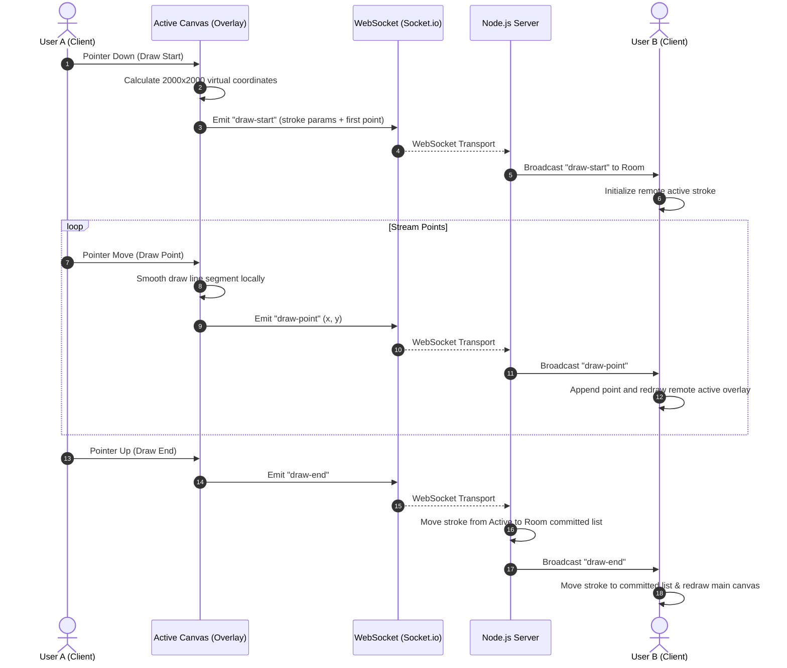

# Architecture & Technical Design

This document details the system design, communication protocols, performance strategies, and conflict-resolution models utilized in PaintSync.

---

## 🗺️ Data Flow Diagram

The diagram below maps the sequence of rendering steps, network loops, and state changes that occur when a user draws on the canvas:

---

## 🔌 WebSocket Communication Protocol

PaintSync utilizes a lightweight, event-driven WebSocket protocol built over Socket.io. Below is the schema of operations:

| Event Name | Direction | Payload Schema | Description |
| :--- | :--- | :--- | :--- |
| `join-room` | Client ➡️ Server | `{ roomId: string, username: string, color: string }` | Client requests to join a room. |
| `room-data` | Server ➡️ Client | `{ users: User[], committedStrokes: Stroke[], activeStrokes: Stroke[] }` | Sent immediately after joining to sync the current canvas state. |
| `user-joined`| Server ➡️ Client | `{ user: User, users: User[] }` | Broadcast to peers when a user enters the room. |
| `user-left`  | Server ➡️ Client | `{ userId: string, users: User[] }` | Broadcast to peers when a user disconnects. |
| `draw-start` | Client ➡️ Server   Server ➡️ Client | `Stroke` | Emitted when drawing starts to initialize path buffers. |
| `draw-point` | Client ➡️ Server   Server ➡️ Client | `{ strokeId: string, point: Point }` | High-frequency point streaming for active lines. |
| `draw-end`   | Client ➡️ Server   Server ➡️ Client | `{ strokeId: string }` | Emitted when pointer is lifted to finalize the stroke. |
| `cursor-move`| Client ➡️ Server   Server ➡️ Client | `{ x: number, y: number }` | Real-time position tracking of the client cursor. |
| `undo`       | Client ➡️ Server | *None* | Client requests to undo their last committed stroke. |
| `stroke-undone`| Server ➡️ Client | `{ strokeId: string }` | Broadcast to room indicating a stroke should be removed. |
| `redo`       | Client ➡️ Server | *None* | Client requests to restore their last undone stroke. |
| `stroke-restored`| Server ➡️ Client | `{ stroke: Stroke }` | Broadcast to room containing the restored stroke. |
| `clear-canvas`| Client ➡️ Server | *None* | Client requests to wipe the board clean. |
| `canvas-cleared`| Server ➡️ Client | *None* | Wipes all canvas layers locally. |
| `ping-test`  | Client ➡️ Server | *Ack Callback* | Used to measure round-trip network latency. |

---

## 🔄 Undo / Redo Synchronization Strategy

Implementing a collaborative undo/redo stack is one of the most complex challenges in multi-user drawing. 

### The Problem
If User A draws Stroke 1, User B draws Stroke 2 (overlapping Stroke 1), and then User A clicks "Undo", a standard global stack would undo User B's Stroke 2. This creates frustration. However, if we only undo User A's Stroke 1, we must modify the history stack out-of-order, which could cause synchronization inconsistencies or overlapping draw order conflicts if clients are not aligned.

### The Solution: User-Specific Chronological Re-rendering
PaintSync resolves this by utilizing **User-Specific Redo/Undo** combined with a **Server-Determined Chronological Master Array**:

1. **Master History Array**: The server maintains a single, flat, chronological array of all strokes: `[Stroke1, Stroke2, Stroke3, ...]`.
2. **Reactivation Flag**: Each stroke contains an `isActive` boolean.
3. **Undo Request**: When User A triggers undo, the client emits `undo`.
4. **Server Scan**: The server scans the master array *backward* starting from the end, finds the last stroke created by User A where `isActive === true`, sets `isActive = false`, pushes it to User A's local redo stack, and broadcasts `stroke-undone` with the `strokeId`.
5. **Client Redraw**: On receiving `stroke-undone`, all clients:
   - Filter out the undone stroke ID from their local memory arrays.
   - Clear the committed canvas completely (`ctx.clearRect(0,0,2000,2000)`).
   - Loop through the remaining active list in chronological order and redraw them.
6. **Redo Request**: When User A triggers `redo`, the server pops the stroke from User A's redo stack, sets `isActive = true` in the master array, and broadcasts `stroke-restored` containing the full stroke. Clients append this stroke to their local history and render it directly.

> [!NOTE]
> Since the order of the master array is never modified (only the `isActive` state of elements changes), the depth overlap layering is preserved. If Stroke 1 (undone) is restored, it renders in its original place underneath Stroke 2, guaranteeing identical states across all client screens.

---

## ⚡ Performance and Optimization Decisions

To support smooth drawing experiences at 60 FPS under high activity, the following design patterns were implemented:

1. **Double-Canvas Rendering Pipeline**:
   Redrawing the entire canvas history on every high-frequency `pointermove` event is slow. We split the rendering into two `<canvas>` layers:
   - **Committed Layer**: Drawn once when strokes are finished. It is static and never cleared during drawing, resulting in zero overhead.
   - **Active Layer**: A transparent overlay. On every mouse move, it clears only its context and draws the current active strokes (the local user's stroke + any active peer strokes). When a stroke is finished, it is painted to the Committed Layer, and the Active Layer is cleared.
2. **Virtual Coordinate Space Projection**:
   Clients use screens of different sizes. To align coordinates, all strokes are projected and serialized in a fixed $2000 \times 2000$ virtual coordinate system. When a pointer event occurs, screen space is mapped:
   $$x_{virtual} = \frac{x_{client} - rect_{left}}{width_{client}} \times 2000$$
   This ensures that no matter how users resize their windows, lines align perfectly.
3. **Pointer Events Integration**:
   Instead of using separate `mousedown/mousemove/mouseup` and `touchstart/touchmove/touchend` events, PaintSync implements **W3C Pointer Events**. This single API handles mouse, stylus, and capacitive touch events natively with native pointer capturing.
4. **DOM-Based Peer Cursor Layer**:
   Drawing other users' cursors on the canvas element itself would require redrawing the canvas on every cursor movement (dozens of times a second per user). PaintSync renders cursors as absolutely positioned DOM elements within a dedicated absolute wrapper container, utilizing GPU-accelerated CSS positioning. This leaves the drawing thread unburdened.
5. **Bézier Path Smoothing**:
   Freehand drawing on a computer is naturally jagged due to input polling rates. We calculate **Quadratic Bézier curves** (`quadraticCurveTo`) between the midpoints of adjacent drawn coordinates:
   $$xc = \frac{x_i + x_{i+1}}{2}, \quad yc = \frac{y_i + y_{i+1}}{2}$$
   This creates beautiful, curved, professional-grade vector brush marks.

---

## 🛡️ Conflict Resolution

Canvas drawing operations are non-destructive modifications on screen, but conflict occurs when network latency causes strokes to arrive out of order.

- **Chronological Server Timestamping**: The server determines the official committed order of strokes. Since drawing data is streamed in real-time, the canvas will reflect the strokes as they happen.
- **State Reconciliation**: By distributing the full initial state (`room-data`) upon joining and emitting clear actions for undos/redos, clients are prevented from drifting. If a user suffers high latency, their lines appear on other users' screens smoothly as the packets arrive, and their final commit order is resolved by the server's master list.
